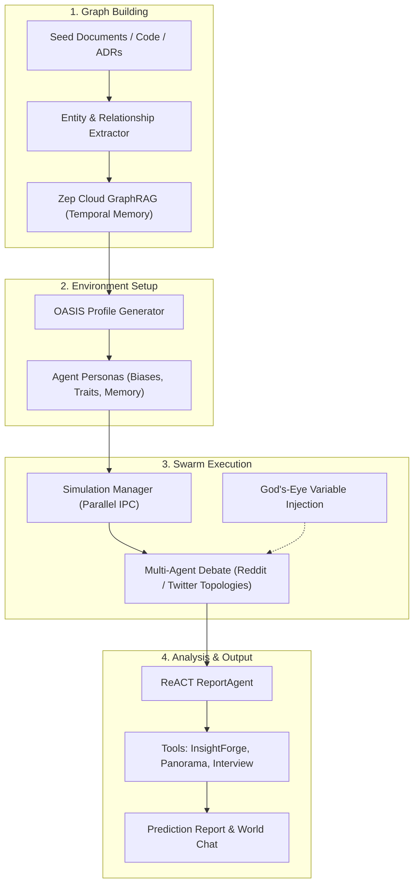

# MiroFish Swarm Intelligence & Predictive Simulation: Integration & Architectural Report for Whyline

---

## Executive Summary

This report evaluates **MiroFish** ([666ghj/MiroFish](https://github.com/666ghj/MiroFish)), an open-source swarm intelligence and multi-agent simulation engine, and defines its role and integration strategy within the **Whyline** project (Voice-Native Codebase Guard & Spoken Fence Compiler).

### Key Installation Status
- **Repository Type**: Full-stack application (Python FastAPI/Zep backend + Vue 3 frontend) rather than a lightweight skill bundle.
- **Skill Registration**: Standardized and packaged into `.agents/skills/mirofish/SKILL.md`, registered in `skills.md`, and indexed in `skills-lock.json` with SHA-256 verification.
- **Primary Value for Whyline**: Moves Whyline from *static syntactic guarding* to *predictive behavioral simulation*—enabling software engineering teams to simulate developer adoption friction, test architectural blast-radius counterfactuals, and red-team spoken fence bypasses before production deployment.

---

## 1. MiroFish Architecture & Internals

MiroFish replaces static predictive models with a high-fidelity digital twin simulation populated by autonomous agents.



### 1.1 Ingestion & Knowledge Graph (GraphRAG via Zep Cloud)
- **Multi-Format Parsing**: Ingests Markdown, PDF, Plaintext, and structured code summaries.
- **Entity & Relation Ontology**: Automatically discovers entity classes and constructs semantic triples.
- **Temporal Memory Episodes**: Ingests batches into Zep Cloud, preserving causality and entity lifecycles.

### 1.2 Persona Synthesis (OASIS Architecture)
- Generates thousands of distinct personas with calibrated attributes:
  - Technical experience, risk aversion, and compliance tendencies.
  - Team alignment, cognitive biases, and communication habits.
  - Private episodic memory alongside shared collective knowledge.

### 1.3 Swarm Simulation Engine
- Coordinates parallel agent interactions across social and architectural topologies.
- Supports **dynamic variable injection** (e.g., simulating a sudden third-party API outage, a 4x traffic surge, or a mandatory strict pre-commit hook).
- Evaluates opinion drift, consensus convergence, and resistance emergence over configurable rounds (20–100 turns).

### 1.4 ReACT Report Agent
- Employs a reasoning loop armed with analytical tools:
  - `insight_forge`: Cross-entity correlation analysis.
  - `panorama`: Macroscopic landscape and sentiment tracking.
  - `interview`: Targeted 1-on-1 interrogation of outlier agents.
  - `zep_search`: Direct semantic traversal of the post-simulation memory state.

---

## 2. Whyline Alignment & High-Leverage Use Cases

Whyline currently enforces invariant fences through Tree-sitter AST detection, PostgreSQL 16 `pgvector` RRF search, and deterministic pre-commit hooks. Integrating MiroFish introduces proactive behavioral intelligence:

| Whyline Capability | Static Baseline | MiroFish Enhanced Capability |
| :--- | :--- | :--- |
| **Spoken Fences** | Blocks commits matching AST anomaly hashes. | **Adoption Simulation**: Forecasts developer circumvention rate (`--no-verify`) before rolling out a new fence. |
| **GatewayRouter Workarounds** | Invariant test verifies 5x retry logic. | **Chaos Swarm Simulation**: Simulates hundreds of client agents hammering the endpoint to detect socket pool starvation. |
| **Knowledge Retrieval** | Single-round-trip RRF across AST & Voice Pins. | **Dual-Source Graph Fusion**: Unifies syntactic AST nodes with temporal causal graphs from simulated incidents. |
| **Invariant Verification** | Generates JUnit 5 and Pytest suites. | **Adversarial Red-Teaming**: Deploys simulated rogue developer personas attempting to bypass fences. |

### Case Study: HealthConnect `GatewayRouter.java` Blast-Radius Simulation
- **Current State**: Whyline guards lines 5–15 of `GatewayRouter.java` using a spoken voice fence (Dr. Reddy's Telugu ADR explaining a 5x retry backoff to survive midnight batch drops).
- **MiroFish Simulation**:
  1. Seed MiroFish with the Java class, the voice pin transcript, and API client specs.
  2. Spawn 100 agent personas (50 internal health sync jobs, 30 external partner clients, 20 high-frequency query workers).
  3. Inject variable: *Midnight DB lockup lasting 6.2 seconds*.
  4. Outcome: MiroFish models whether 5x exponential retry cascades into connection buffer exhaustion, predicting downstream timeout rates before staging deployment.

---

## 3. Skill Packaging & Workspace Registration

Because MiroFish is an application rather than a pre-bundled agent skill, the following workspace assets have been configured:

1. **Skill Definition**: Created at [`.agents/skills/mirofish/SKILL.md`](file:///c:/Users/anjan/Downloads/Whyline/.agents/skills/mirofish/SKILL.md)
   - Exposes triggers for swarm simulation, counterfactual blast-radius prediction, and GraphRAG modeling.
2. **Catalog Registration**: Added to [`skills.md`](file:///c:/Users/anjan/Downloads/Whyline/skills.md) under Group *Swarm Intelligence*.
3. **Integrity Lock**: Recorded in [`skills-lock.json`](file:///c:/Users/anjan/Downloads/Whyline/skills-lock.json) with SHA-256 verification (`da53313fbd...`).

---

## 4. Technical Integration Architecture: Whyline ↔ MiroFish Bridge

To run simulations directly from Whyline, a bridge script connects Whyline's FastMCP server and AST store to MiroFish's simulation runner:

```python
"""
Conceptual Whyline-to-MiroFish Bridge
Transforms Whyline AST fences into MiroFish seed inputs for blast-radius deduction.
"""
import json
from pathlib import Path

def export_whyline_fences_to_mirofish_seed(
    fences_json_path: Path, 
    code_path: Path, 
    output_seed_path: Path
):
    with open(fences_json_path, "r", encoding="utf-8") as f:
        fences = json.load(f)
    
    code_content = code_path.read_text(encoding="utf-8")
    
    seed_document = f"""# Whyline Architectural Simulation Seed

## Target Code Artifact: {code_path.name}
```java
{code_content}
```

## Active Spoken Fences & Constraints
"""
    for fence in fences:
        seed_document += f"""
### Fence: {fence.get('symbol_name', 'Global')} (Hash: {fence.get('ast_signature_hash')})
- Author: {fence.get('author_handle', 'Unknown')}
- Transcript: {fence.get('transcript_raw', '')}
- Constraint: {fence.get('constraint_summary', '')}
"""
    
    output_seed_path.parent.mkdir(parents=True, exist_ok=True)
    output_seed_path.write_text(seed_document, encoding="utf-8")
    return output_seed_path
```

---

## 5. Deployment & Prerequisites

### Required Environment Configuration
Add the following to your root `.env` file when operating MiroFish:

```env
# LLM Endpoint (OpenAI SDK Compatible)
LLM_API_KEY=your_api_key
LLM_BASE_URL=https://api.openai.com/v1  # or DashScope, Gemini OpenAI-compatible endpoint
LLM_MODEL_NAME=gpt-4o                   # or qwen-plus, gemini-2.5-flash

# Knowledge Graph Service
ZEP_API_KEY=your_zep_api_key
```

### Standalone Engine Installation
To launch the full visual MiroFish workbench alongside Whyline:

```bash
# 1. Clone MiroFish
git clone https://github.com/666ghj/MiroFish.git tools/mirofish
cd tools/mirofish

# 2. Install dependencies (Node 18+ and Python 3.11/3.12 with uv)
npm run setup:all

# 3. Start development server
npm run dev
```

> [!WARNING] Token Consumption Notice
> Multi-agent swarm simulations with 1,000+ agents across 50 rounds generate high token volumes. Always configure simulation rounds (`--rounds 20` to `30`) and agent population caps during initial scenario calibration.
