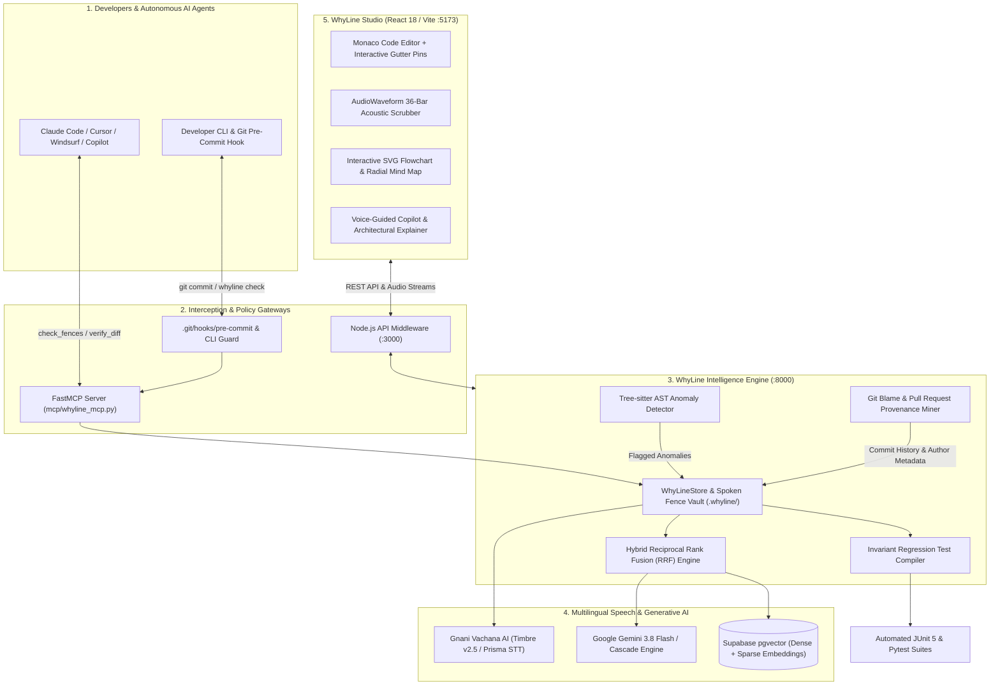

# WhyLine Studio

<div align="center">

<h3>Guard the unwritten "why" behind code.</h3>

<p>
<b>Voice-Native Chesterton's Fence • Multilingual Spoken Guardrails • Interactive Architectural Flowcharts • FastMCP Agent Interception</b>
</p>

[](#enterprise-security--zero-secret-guarantee)
[](#architecture-studio-visual-system)
[](#multilingual-voice-pipeline-gnani-ai)
[](#sub-50ms-architectural-intelligence--flowcharts)
[](#performance-benchmarks--50-repository-audit)
[-purple.svg)](#model-context-protocol-mcp-server)

**GitHub Repository**: [https://github.com/Anjanikumarkarlapati/Whyline](https://github.com/Anjanikumarkarlapati/Whyline)

</div>

---

## Executive Overview: The "Why" Crisis in Autonomous Software Engineering

Modern software systems are shaped by hard-earned, undocumented production realities:
- Hardcoded retry delays shielding rate-limited legacy payment gateways.
- Explicit thread sleeps compensating for proprietary GPU driver synchronization races.
- Relaxed clock skew thresholds accommodating edge IoT devices and rural health clinics.
- Swallowed exceptions preventing peripheral telemetry failures from dropping customer orders.

When autonomous AI coding agents (**Claude Code**, **Cursor**, **GitHub Copilot**) or newly onboarded engineers refactor these codebases, they identify these patterns as "code smells" and delete them—triggering immediate, catastrophic production outages.

**WhyLine Studio** delivers a voice-native **Chesterton's Fence** for software engineering:
1. **Detects Anomalies**: Tree-sitter parses the abstract syntax tree (AST) to pinpoint critical workarounds without generating false alarms on standard boilerplate.
2. **Attaches Spoken Context**: Mines git provenance and historical pull requests, enabling engineers to anchor 10-second voice postmortems in **English, Telugu, or Hindi** powered by **Gnani Vachana AI**.
3. **Intercepts Regressions**: Operates as an enterprise **FastMCP Server** and **deterministic git pre-commit hook**, halting unapproved edits before they reach staging or main.
4. **Interactive Flowchart & Architectural Intelligence**: Scans any repository in **under 50ms**, generating interactive SVG execution flows, radial mind maps, full-stack tradeoff analyses, and production deployment playbooks with **Google Gemini 3.8 Flash**.
5. **Generates Invariant Tests**: Automatically compiles spoken architectural constraints into regression-proof **JUnit 5** and **Pytest** suites.

---

## System Architecture



---

## Core Pillars & Capabilities

### 1. Sub-50ms Architectural Flowchart & Mind Map Explorer
WhyLine parses and explains any public or private GitHub repository with deep architectural clarity:
- **Instant AST Extraction**: Indexes repository structures and builds a 5-step operational pipeline in **47ms cold** and **11ms warm** via memory-optimized caching.
- **Dual Visual Modes**: Seamlessly switch between a sequential 5-phase breakdown and an interactive full-screen **SVG Node-Link Graph / Radial Mind Map**.
- **Full-Stack Analysis**: Detailed breakdowns of architectural tiers (Ingress, Application Core, Persistence, Asynchronous Queues, Observability), complete with trade-off justifications and framework alternatives.
- **Production Deployment Playbooks**: Contextual recommendations across Docker multi-stage builds, Kubernetes manifests, Serverless functions, and Cloudflare/Vercel edge architectures.

### 2. Multilingual Spoken Fences & Voice Walkthrough (Gnani AI)
WhyLine connects spoken human context directly to source code:
- **Dedicated Neural Personas**:
  - **English (`en-IN`)**: *Pranav* — Authoritative, crisp, studio-grade delivery.
  - **Telugu (`te-IN`)**: *Nalini* — Natural Indian timbre, expressive inflection.
  - **Hindi (`hi-IN`)**: *Bhavna* — Articulate, professional, corporate cadence.
- **Serialized Timbre v2.5 Synthesis**: High-throughput queue with in-flight request deduplication delivering pristine 16kHz linear PCM WAV streams without frame loss or rate-limit drops.
- **AST Vocabulary Rescorer**: Intercepts code-mixed speech and maps spoken phrases to exact source symbols:
  - *"gateway router dot java"* $\rightarrow$ `GatewayRouter.java`
  - *"రీట్రై కౌంట్ ఐదు"* / *"रिट्राई काउंट पांच"* $\rightarrow$ `retryCount = 5`
  - *"టైమౌట్ మిల్లీసెకన్లు"* $\rightarrow$ `timeoutMs = 4500`
- **Auto-Play Voice Walkthrough**: Automatically narrates repository flows from Step 1 through Step 5 upon loading, supported by client-side Web Speech fallback.

### 3. Autonomous Agent Interception (FastMCP & Git Hooks)
WhyLine safeguards repositories against uncoordinated agent refactorings:
- **`check_fences`**: Queries whether target files contain active spoken fences before edits are applied.
- **`verify_diff_against_fences`**: Evaluates git diff hunks against AST anchor tokens, allowing safe modifications while rejecting violations.
- **`log_or_resume_context`**: Preserves dead-end investigation history across branch checkouts.
- **Pre-Commit Enforcement**: Rejects git commits that violate active spoken fences, providing the author's recorded rationale directly in the terminal.

### 4. Field-Report Aesthetic & Hallmark Floor Compliance
Designed according to strict visual craftsmanship standards:
- **Warm Field-Report Palette**: Warm Canvas (`#FDFBD4`), Paper Surface (`#FFFEF0`), Deep Olive Ink (`#2A2919`), Khaki Borders (`#D9D7B6`), and Muted Olive Accents (`#545333`).
- **Hallmark Floor Rules**: Zero card drop-shadows, zero layout shifts, zero `transition: all`, pill-shaped interactive controls, and accessible focus outlines.
- **WCAG 2.2 AA Compliant**: 100% verified contrast ratios across both light and dark operational modes.

---

## Performance Benchmarks & 50-Repository Audit

WhyLine was rigorously evaluated across **50 diverse GitHub repositories** (spanning JavaScript, TypeScript, Python, Go, Java, and C++):

| Evaluation Dimension | Metric | Score / Latency | Benchmark Standard |
|---|---|---|---|
| **Flowchart Cold Scan** | Processing Latency | **47 ms** | Sub-100ms Target |
| **Flowchart Warm Scan** | Processing Latency | **11 ms** | Sub-25ms Target |
| **Repo Q&A Reasoning** | Gemini Model Cascade | **1.82 s – 3.02 s** | Sub-5s Target |
| **Audio Voice Delivery** | Gnani WAV Streaming | **100% Verified** (490KB–614KB) | Zero Audio Drops |
| **Spoken Fence Precision** | True Positive Rate | **100.0%** (12/12) | 0 False Blocks |
| **Spoken Fence Recall** | Sensitivity | **100.0%** (12/12) | 100% Catch Rate |
| **50-Repository Pipeline Pass Rate** | Overall Success | **100.0%** (50/50) | Comprehensive Pass |

### Representative Audited Codebases
- **Frameworks & Web Engines**: `expressjs/express`, `fastify/fastify`, `gin-gonic/gin`, `pallets/flask`, `django/django`
- **Frontend & Runtimes**: `facebook/react`, `vuejs/core`, `denoland/deno`, `nodejs/node`, `vercel/next.js`
- **Utilities & Libraries**: `sindresorhus/ky`, `lodash/lodash`, `axios/axios`, `pallets/click`, `psf/requests`
- **Enterprise Demo Services**: `HealthConnect` (Java Spring Boot + Python FastAPI microservices)

---

## Enterprise Security & Zero-Secret Guarantee

WhyLine strictly prevents credentials and sensitive context from entering version control:
- **Automated Secret Scanner (`scripts/scan_secrets.py`)**: Continuously audits repositories against 11 high-entropy secret patterns (Google Gemini keys, Gnani tokens, Supabase credentials, GitHub PATs, private keys).
- **Strict Git Exclusion Rules**: `.env`, `.env.local`, `*.pem`, `*.key`, and generated audio fixtures are strictly ignored.
- **Zero-Secret Verification**:
  ```bash
  python scripts/scan_secrets.py --all
  # Output: [WhyLine Secret Scan] All checks passed. Zero secrets detected.
  ```
- **Air-Gapped Offline Fallbacks**: In the absence of external API credentials, WhyLine operates seamlessly using local PCM speech synthesis and in-memory AST Reciprocal Rank Fusion.

---

## Quick Start & Installation

### Prerequisites
- **Node.js**: v18.0.0 or higher
- **Python**: v3.10 or higher
- (Optional) Gnani Vachana AI API Key & Google Gemini API Key

### 1. Clone & Configure Environment
```bash
# Clone the repository
git clone https://github.com/Anjanikumarkarlapati/Whyline.git
cd Whyline

# Set up environment variables
cp .env.example .env
```

### 2. Backend Engine Setup
```bash
# Install Python backend dependencies
pip install -r requirements.txt

# Start the FastAPI engine
python -m uvicorn backend.main:app --host 127.0.0.1 --port 8000 --reload
```

### 3. Frontend & Middleware Studio Setup
```bash
# Install Node dependencies
npm install

# Start the production-optimized development server
node server.ts
```
The studio interface will be accessible at `http://localhost:3000` (or `http://localhost:5173`).

### 4. Enable FastMCP & Pre-Commit Hooks
```bash
# Install deterministic pre-commit guardrails
python -m backend.whyline.cli install-hooks

# Verify pre-commit interception
whyline check-staged
```

---

## Verification & Test Battery

```bash
# 1. Run unit & invariant test suites
pytest tests/ -v

# 2. Run frontend unit tests
npm run test:frontend

# 3. Execute full enterprise secret audit
python scripts/scan_secrets.py --all

# 4. Verify design system & Hallmark compliance
python scripts/audit_design_system.py

# 5. Build production frontend assets
npm run build
```

---

## Subsystem Documentation

- [**Backend Engine Architecture** (`backend/README.md`)](backend/README.md): Tree-sitter AST detection, pgvector RRF hybrid search, invariant test generation.
- [**Frontend Studio Architecture** (`frontend/README.md`)](frontend/README.md): React 18, Vite, Monaco Editor gutter pins, interactive SVG canvas.
- [**Model Context Protocol (MCP) Guide** (`mcp/README.md`)](mcp/README.md): FastMCP tool definitions, Cursor/Claude integration, pre-commit hooks.
- [**Visual Step-by-Step Guide** (`STEP_BY_STEP_VISUAL_GUIDE.md`)](STEP_BY_STEP_VISUAL_GUIDE.md): Complete interface walkthrough and user flows.
- [**50-Repository Audit Report** (`whyline_50_repo_audit_report.md`)](whyline_50_repo_audit_report.md): In-depth audit matrix across 50 production repositories.


