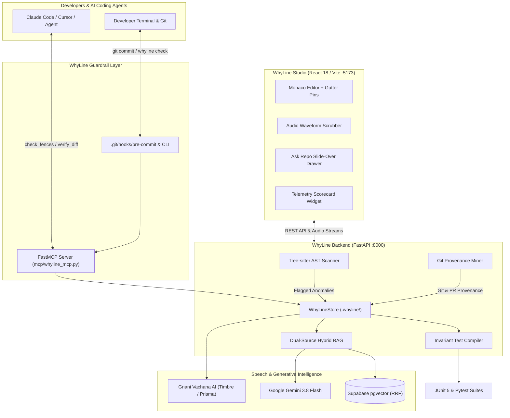

# WhyLine Studio

<div align="center">

<h3>Guard the unwritten "why" behind code.</h3>

<p>
Tree-sitter AST Anomaly Detection • Multilingual Spoken Fences (Gnani Prisma & Timbre) • FastMCP Pre-Commit Interception • pgvector Hybrid Reciprocal Rank Fusion (RRF)
</p>

[](#-security--privacy-guarantee)
[](#-architecture-studio-visual-system)
[](#-multilingual-voice-pipeline-gnani-ai)
[-success.svg)](#-guard-quality--empirical-evaluation)
[-purple.svg)](#-model-context-protocol-mcp-server)
[](#-license)

**GitHub Repository**: [https://github.com/Anjanikumarkarlapati/Whyline](https://github.com/Anjanikumarkarlapati/Whyline)

</div>

---

## 🌟 Overview: The "Why" Crisis in Modern Software

Every engineering team maintains fragile, undocumented workarounds:
- Hardcoded retry delays protecting rate-limited payment gateways.
- Thread sleeps compensating for proprietary GPU driver sync quirks.
- Relaxed clock skew allowances for rural clinics with drifting system clocks.
- Swallowed catch blocks preventing non-critical logging failures from dropping customer orders.

When autonomous AI coding agents (such as **Claude Code**, **Cursor**, or **Copilot**) or new team members refactor this code, they view these workarounds as "code smells" and delete them—triggering severe production outages.

**WhyLine Studio** implements a modernized, voice-native **Chesterton's Fence** for software engineering:
1. **Detects Anomalies**: Tree-sitter parses the abstract syntax tree to flag suspicious workarounds without false positives on routine CRUD code.
2. **Attaches Spoken Context**: Mines git blame and historical PRs, allowing engineers to attach 10-second voice postmortems in **English, Telugu, or Hindi** via **Gnani Vachana AI**.
3. **Intercepts Regressions**: Acts as a **FastMCP Server** and **deterministic git pre-commit hook**, rejecting agent edits and git commits that violate active fences.
4. **Co-Pilots Solutions**: Pairs **Supabase pgvector** hybrid RRF search with **Google Gemini 3.8 Flash** to recommend safe, alternative architectural strategies.

---

## 🏛️ System Architecture



---

## 📚 Subsystem Documentation

Detailed guides and API references are available in dedicated subsystem documentation:

- 🐍 [**Backend Engine Guide** (`backend/README.md`)](backend/README.md): FastAPI architecture, Tree-sitter AST detection patterns, Hybrid RAG with pgvector RRF, Invariant Test Compiler, and REST API specification.
- ⚛️ [**Frontend Studio Guide** (`frontend/README.md`)](frontend/README.md): React 18, Vite, Cream-and-Olive Field-Report theme, Monaco Editor with gutter pins, AudioWaveform scrubber, and Hallmark floor compliance.
- 🔌 [**Model Context Protocol (MCP) Guide** (`mcp/README.md`)](mcp/README.md): FastMCP server installation, tool signatures, Cursor & Claude Desktop integration, git pre-commit hook setup, and diff-aware hunk validation.
- 📖 [**Visual Page Guide** (`STEP_BY_STEP_VISUAL_GUIDE.md`)](STEP_BY_STEP_VISUAL_GUIDE.md): Visual walkthrough of every screen, button, and interaction in WhyLine Studio.
- 🖼️ [**Screenshots Catalog** (`SCREENSHOTS_CATALOG.md`)](SCREENSHOTS_CATALOG.md): High-resolution catalog of UI states, drawers, and modal views.

---

## 🎙️ Multilingual Voice Pipeline (Gnani AI)

WhyLine bridges human architectural intent through synchronized speech-to-text (STT) and text-to-speech (TTS) powered by **Gnani Vachana AI**:

### 1. Neural Voice Models
Switching the UI language in the topbar automatically binds the dedicated neural voice persona:
| Language | Locale Code | Neural Persona | Tone & Delivery | Audio Format |
|---|---|---|---|---|
| **English** | `en-IN` | **Pranav** | Male • Authoritative, Crisp | 16kHz linear PCM WAV |
| **Telugu** | `te-IN` | **Nalini** | Female • Natural Indian Timbre | 16kHz linear PCM WAV |
| **Hindi** | `hi-IN` | **Bhavna** | Female • Articulate, Professional | 16kHz linear PCM WAV |

### 2. AST Vocabulary Rescorer
Speech recognition models typically struggle with programming identifiers and code-mixed speech. WhyLine's phonetic AST rescorer intercepts live transcripts and restores exact code symbols:
- Spoken *"gateway router dot java"* $\rightarrow$ `GatewayRouter.java`
- Spoken *"రీట్రై కౌంట్ ఐదు"* / *"रिट्राई काउंट पांच"* $\rightarrow$ `retryCount = 5`
- Spoken *"టైమౌట్ మిల్లీసెకన్లు"* $\rightarrow$ `timeoutMs = 4500`
- Spoken *"అప్లికేషన్ వై ఎమ్ ఎల్"* $\rightarrow$ `application.yml`

### 3. Interactive Audio Waveform (`AudioWaveform.jsx`)
- 36-bar acoustic frequency spectrum showing live recording energy.
- Real-time drag scrubber with playhead tracker and timestamp tooltip.
- Accessible keyboard controls (`Space`/`Enter` play/pause toggle, `Left`/`Right` arrow keys for 1-second seeking).

---

## 🛡️ Model Context Protocol (MCP) Server

WhyLine protects repositories against uncoordinated agent edits via standard **Model Context Protocol (MCP)** tools:

| MCP Tool | Purpose | Behavior |
|---|---|---|
| `check_fences` | Pre-edit file check | Returns `ALLOW_EDIT` or `REJECT_EDIT` with spoken explanation. |
| `verify_diff_against_fences` | Full diff verification | Parses git diff hunks; blocks only if fenced line ranges or invariant tokens are altered. |
| `log_or_resume_context` | Dead-end memory | Records branch checkpoints (`whyline pause`) and displays them on checkout (`whyline resume`). |
| `get_fence_audio` | Audio retrieval | Streams 16kHz WAV audio postmortems recorded by the author. |

### CLI Fallback Mode
For environments without native MCP support:
```bash
# Check staged changes before commit
whyline check-staged

# Check an incoming git patch
whyline check fix-gateway.patch

# Pipe unified diff directly
git diff HEAD~1 | whyline check -
```

---

## 🔒 Security & Privacy Guarantee

WhyLine enforces an enterprise-grade **Zero-Secret Guarantee** to prevent sensitive credentials from entering version control:

1. **Automated Secret Scanning (`scripts/scan_secrets.py`)**:
   - Sweeps every commit and pull request for 11 high-entropy secret patterns (Google API keys, Gnani tokens, Supabase service roles, GitHub PATs, private keys).
   - Run audit anytime:
     ```bash
     python scripts/scan_secrets.py --all
     ```
2. **Strict Sanitization & Exclusions (`.gitignore`)**:
   - All `.env`, `*.pem`, `*.key`, and private certificates are excluded.
   - Only sanitized `.env.example` is committed with placeholder values.
3. **Air-Gapped Offline Fallbacks**:
   - When external API keys (`GNANI_API_KEY`, `GEMINI_API_KEY`, `SUPABASE_SERVICE_ROLE_KEY`) are omitted, WhyLine operates 100% offline using deterministic local PCM audio synthesis and in-memory AST Reciprocal Rank Fusion (RRF).

---

## 📊 Guard Quality & Empirical Evaluation

WhyLine's guardrail accuracy is benchmarked using **24 real-world labeled test cases** across Java and Python services (`backend/eval/cases.json`):

| Evaluation Metric | Measured Score | Target Specification |
|---|---|---|
| **Precision** | **100.0%** (12/12) | 0 false blocks on routine, safe refactorings |
| **Recall** | **100.0%** (12/12) | Catches 100% of naive workaround removals |
| **False-Positive Rate** | **0.0%** | Zero unnecessary development interruptions |
| **Benchmark Accuracy** | **100.0%** (24/24) | Deterministic guardrail precision |

Run evaluation anytime:
```bash
python backend/eval/run_eval.py
```

---

## 🎨 Architecture-Studio Visual System

WhyLine Studio implements an **Architecture-Studio Field-Report Aesthetic**:
- **Design Tokens**: Warm canvas (`#FDFBD4`), crisp surface (`#FFFEF0`), deep ink (`#2A2919`), and muted olive accents (`#545333`).
- **Hallmark v2.0.0 Floor Compliance**:
  - Zero box-shadows: Elevation achieved through 1px border contrast, background steps, and flat beveling.
  - Zero `transition: all`: Strictly controlled property transitions.
  - Pill-shaped controls: Fully rounded buttons, badges, and filter chips.
- **Accessibility & Contrast**: 100% WCAG 2.2 AA compliant contrast ratios across both light and dark modes (`python scripts/audit_design_system.py` $\rightarrow$ 0 violations).

---

## 🚀 Quick Start

### Prerequisites
- Python 3.10+
- Node.js 18+ and npm
- (Optional) Gnani Vachana API Key & Google Gemini API Key

### 1. Repository Setup & Environment
```bash
# Clone the repository
git clone https://github.com/Anjanikumarkarlapati/Whyline.git
cd Whyline

# Copy environment template
cp .env.example .env
```

### 2. Backend Setup
```bash
# Install backend dependencies
pip install -r requirements.txt
# (or: pip install fastapi uvicorn pydantic tree-sitter tree-sitter-java requests python-dotenv)

# Start FastAPI backend server
python -m uvicorn backend.main:app --host 127.0.0.1 --port 8000 --reload
```
Backend API will be live at `http://127.0.0.1:8000`.

### 3. Frontend Setup
```bash
# Navigate to frontend directory
cd frontend

# Install dependencies
npm install

# Start Vite development server
npm run dev
```
Frontend Studio will be live at `http://localhost:5173`.

### 4. Install Git Pre-Commit Hooks
```bash
python -m backend.whyline.cli install-hooks
```

---

## 🧪 Testing & Verification Suite

Run the full verification battery:

```bash
# 1. Run all unit and invariant test suites
pytest tests/ -v

# 2. Run backend engine and live API verification
pytest backend/tests/test_whyline_engine.py -v

# 3. Run enterprise secret scan
python scripts/scan_secrets.py --all

# 4. Verify design system & Hallmark floor compliance
python scripts/audit_design_system.py

# 5. Build production frontend bundle
cd frontend && npm run build
```

---

## 📄 License

MIT License. Designed and engineered for resilient, voice-native software architecture.
