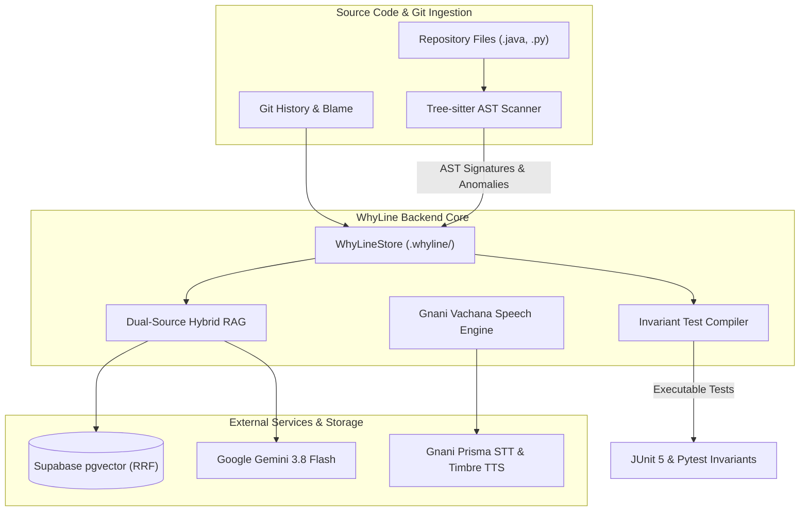

# WhyLine Backend Engine

> **AST Anomaly Detection, Multilingual Speech Bridge, Hybrid pgvector RRF, and Invariant Test Compiler.**

The WhyLine backend powers the core intelligence behind WhyLine Studio. It inspects source code using Tree-sitter AST parsing, bridges spoken audio notes via Gnani Vachana AI, indexes code semantics via Supabase pgvector Reciprocal Rank Fusion (RRF), and compiles architectural constraints into executable test suites.

---

## Architecture & Core Subsystems



The backend is organized into 5 primary services:
1. **Tree-sitter AST Anomaly Scanner** (`backend/whyline/ast_scanner.py`): Deterministic AST parser detecting 5 fragile code patterns with zero false-positives on routine CRUD.
2. **Provenance Miner** (`backend/whyline/provenance_miner.py`): Correlates AST anomalies with git commit logs, PR descriptions, and author history.
3. **Gnani Speech Client** (`backend/services/gnani_client.py`): Neural speech synthesis (Timbre v2.5) and recognition (Prisma v2.5) across English (`en-IN`), Telugu (`te-IN`), and Hindi (`hi-IN`).
4. **Dual-Source Hybrid RAG Service** (`backend/services/rag_service.py`): Generates 384-dimensional embeddings (multilingual MiniLM-L12-v2), executes pgvector RRF searches, and prompts Gemini 3.8 Flash for 3 ranked architectural strategies.
5. **Invariant Test Compiler** (`backend/services/test_compiler.py`): Compiles active voice constraints into executable JUnit 5 and Pytest regression suites.

---

## Directory Structure

```
backend/
├── app.py                      # FastAPI REST application & routing
├── main.py                     # ASGI server entrypoint
├── migrations/
│   └── 01_init.sql             # PostgreSQL 16 pgvector schema & RRF RPC
├── services/
│   ├── gnani_client.py         # Gnani Vachana TTS/STT client & audio DSP
│   ├── rag_service.py          # MiniLM embeddings & Gemini 3.8 Flash RAG
│   └── test_compiler.py        # Invariant test generator (JUnit 5 / Pytest)
├── whyline/
│   ├── ast_scanner.py          # Tree-sitter AST anomaly detection engine
│   ├── cli.py                  # CLI dispatch entrypoint
│   ├── cli_and_hooks.py        # Git hooks installer & check commands
│   ├── fence_compiler.py       # Fence compilation & serialization
│   ├── git_narration.py        # Git history voice narrative generator
│   ├── git_scanner.py          # Repository structure & flowchart generator
│   ├── gnani_speech.py         # Speech wrapper & local synthesis fallback
│   ├── mcp_server.py           # FastMCP engine for AI coding agent interception
│   ├── provenance_miner.py     # Blame miner & historical PR correlator
│   ├── repo_flowchart.py       # Architecture dependency graph generator
│   └── store.py                # Ledger storage & benchmark scorecard state
├── tests/                      # Unit, E2E, and regression test suites
└── eval/
    ├── cases.json              # 24 labeled evaluation cases (12 block, 12 pass)
    └── run_eval.py             # Benchmark accuracy & precision evaluation runner
```

---

## REST API Reference

The backend exposes a FastAPI REST API (default `http://127.0.0.1:8000`).

### 1. Spoken Fences & Briefing
- **`GET /api/briefing`**: Returns live telemetry KPIs, active fence summaries, and scorecard metrics.
- **`GET /api/fences`**: Returns array of all active, pending, historical, and expired fences.
- **`POST /api/fences/confirm`**: Records a 10-second voice postmortem, updating fence status from `PENDING_CONFIRMATION` to `VERIFIED_ACTIVE`.
- **`POST /api/fences/check`**: Evaluates proposed code diffs against active fences.

### 2. Architectural Co-Pilot
- **`POST /api/copilot/ask`**:
  - Request: `{ "question": "string", "language": "en-IN" | "te-IN" | "hi-IN", "audio_base64": "string?" }`
  - Response: `{ "spoken_reply": "string", "audio_url": "string", "ranked_strategies": [ { "id": 1, "title": "string", "risk_level": "LOW", ... } ] }`

### 3. Speech & Audio
- **`POST /api/gnani/stt`**: Transcribes input speech via Gnani Prisma v2.5 with AST vocabulary rescoring.
- **`POST /api/gnani/tts`**: Synthesizes speech via Gnani Timbre v2.5 into 16kHz linear PCM WAV.
- **`GET /api/audio/{filename}`**: Streams 16kHz WAV audio files.

### 4. Git Repository Scanner & Architecture Flowcharts
- **`POST /api/git/scan`**: Clones or reads a git repository, parses files, and outputs architecture flowcharts in JSON and Mermaid formats.

---

## Tree-sitter AST Anomaly Detector

WhyLine flags 5 high-risk code smells where undocumented workarounds typically hide:

| Anomaly Pattern | Target Rule | Example Pattern |
|---|---|---|
| `MAGIC_LITERAL_CONTROL_FLOW` | Hardcoded numeric timeout or retry limits in loops/delays | `retryCount = 5`, `timeoutMs = 4500` |
| `EXPLICIT_THREAD_HALT` | Direct thread suspension avoiding race conditions | `Thread.sleep(120)` |
| `SWALLOWED_EXCEPTION` | Empty catch block masking hardware or gateway faults | `catch (Exception e) {}` |
| `VALIDATION_BYPASS` | Disabled certificate or signature verification | `allowAllHostnames()`, `trustAllCerts()` |
| `REVERT_COMMIT` | Code introduced by a revert commit without comment | Git blame with `Revert "..."` |

### Deterministic AST Signature Hashing
Every anomaly receives an immutable signature hash:
$$\text{ast\_signature\_hash} = \text{MD5}(file\_path \parallel class\_name \parallel method\_name \parallel params)[0:16]$$
This guarantees fence tracking survives refactorings, line number shifts, and comment edits.

---

## Dual-Source Hybrid RAG & pgvector RRF

When answering developer queries, WhyLine computes reciprocal rank fusion across both full-text keyword search and semantic vector similarity:

$$RRF(d) = \frac{1}{k + r_{FTS}(d)} + \frac{1}{k + r_{vector}(d)}$$
*(where $k = 60$ default smoothing parameter)*

1. **Embedding**: Generates 384-dimensional dense vectors using `paraphrase-multilingual-MiniLM-L12-v2`.
2. **Storage**: Matches against PostgreSQL table `ast_nodes` (HNSW cosine index) joined with `voice_pins` via `match_whyline_code_and_fences`.
3. **Synthesis**: Prompts Google Gemini 3.8 Flash via `google-genai` SDK to generate structured JSON containing:
   - Spoken natural language summary in the user's selected language.
   - 3 ranked architectural strategies with safety analysis and risk scoring.

---

## Environment Configuration (`.env`)

```ini
# Gnani Vachana AI Speech Credentials
GNANI_API_KEY=your-gnani-vachana-api-key
GNANI_STT_URL=https://api.vachana.ai/stt/v3
GNANI_TTS_URL=https://api.vachana.ai/api/v1/tts/inference

# Google Gemini API
GEMINI_API_KEY=your-gemini-api-key

# Supabase pgvector Database (Optional - operates with in-memory RRF fallback if unset)
SUPABASE_URL=https://your-project.supabase.co
SUPABASE_SERVICE_ROLE_KEY=your-supabase-service-role-secret-key

# Security & Webhook Signatures
WHYLINE_WEBHOOK_SECRET=your-random-webhook-secret-here
```

---

## Testing & Verification

```bash
# 1. Run all backend tests
pytest backend/tests/ -v

# 2. Run adversarial challenge suite
pytest backend/tests/test_adversarial_challenge_m2.py -v

# 3. Run benchmark evaluation
python backend/eval/run_eval.py
```
