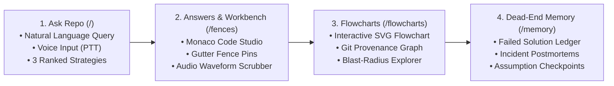

# WhyLine Frontend Studio

> **Architecture-Studio Field-Report Workbench for Protected Codebases.**  
> Built with React 18, Vite, Monaco Editor, Web Audio API, and Hallmark v2.0.0 Floor Compliance.

WhyLine Frontend Studio delivers a serene, distraction-free environment for inspecting codebase anomalies, listening to multilingual spoken architectural decision records (Spoken ADRs), and exploring dependency flowcharts.

---

## 🎨 Visual Identity & Design Tokens

WhyLine Studio strictly follows the **Architecture-Studio Field Report Aesthetic** inspired by engineering field journals:

| Token Name | Light Mode Value | Dark Mode Value | Usage Description |
|---|---|---|---|
| `--bg-base` | `#FDFBD4` | `#1C1C12` | Canvas page and topbar background |
| `--bg-surface` | `#FFFEF0` | `#25251A` | Cards, input fields, editor wells |
| `--bg-raised` | `#F2F0CA` | `#2F2F22` | Table headers, code blocks, filter chips |
| `--text-primary` | `#2A2919` | `#FDFBD4` | High-contrast body copy and headings |
| `--text-secondary` | `#545333` | `#D9D7B6` | Labels, metadata, and helper text |
| `--border-default` | `#D9D7B6` | `#3A3A2A` | 1px hairline card borders and dividers |
| `--border-strong` | `#878672` | `#878672` | Outline for active controls and interactive states |
| `--accent` | `#545333` | `#D9D7B6` | Primary buttons, active underlines, links |
| `--status-good` | `#545333` | `#D9D7B6` | Verified active fence (Olive, never green) |
| `--status-warning` | `#8F5A08` | `#D9A520` | Pending voice confirmation (Warm Amber) |
| `--status-critical` | `#B3261E` | `#E86A62` | Blocked AI agent edits & incidents (Brick Red) |

### Non-Negotiable Hallmark Floor Rules
1. **Zero Box-Shadows**: Elevation is achieved purely through 1px border contrast, background steps, and flat beveling.
2. **Zero `transition: all`**: Only explicit properties (`opacity`, `transform`, `background-color`) transition with $\le 200\text{ms}$ duration.
3. **Pill-Shaped Controls**: All buttons, badges, status pills, and filters are fully rounded (`border-radius: 9999px`).
4. **WCAG 2.2 AA Contrast**: 100% verified color contrast ratios across both light and dark themes.

---

## 🗺️ 4-Page Core Information Architecture



1. **Ask Repo (`/`)**: Central search bar and voice query input. Developer asks questions, selects an Indic language, and receives spoken responses with recommended code patches.
2. **Answers & Code Workbench (`/fences` or `/workbench`)**:
   - Split-pane layout: Monaco Editor on the left showing protected files (e.g., `GatewayRouter.java`), and contextual side panels on the right:
     - **Code Rules Tab**: Inspects active fences, line ranges, and danger conditions.
     - **Code History Tab**: Shows historical commits, PR #212 provenance, and incident postmortems.
     - **Ask Repo Tab**: Dedicated co-pilot strategy runner.
3. **Flowcharts & Git Explorer (`/flowcharts`)**: Interactive architectural graphs mapping services, dependencies, and git history nodes.
4. **Dead-End Memory & Incidents (`/memory` or `/incidents`)**: Ledger of ruled-out solutions (`whyline pause`), preventing engineers from repeating discarded debugging approaches.
5. **Settings & Session (`/settings`)**: Controls gateway version toggle (v1 $\leftrightarrow$ v2), theme selection (Paper Light / Khaki Dark), and developer session mode.

---

## 🧩 Key Components

### 1. Monaco Code Studio (`MonacoCodeStudio.jsx`)
- Full Monaco code editor customized with the WhyLine Cream-and-Olive theme (`monacoTheme.js`).
- Gutter decorations (`glyphMargin`) displaying shield icons on fenced lines (e.g., lines 5–15).
- Hover tooltips detailing why lines are protected and linking directly to the Spoken ADR.

### 2. Audio Waveform Scrubber (`AudioWaveform.jsx`)
- 36-bar acoustic spectrum displaying real-time recording energy.
- Interactive drag scrubber with playhead tracker and timestamp tooltip.
- Accessible keyboard navigation (`Space`/`Enter` play toggle, `Left`/`Right` arrow keys for 1-second seeking).

### 3. Ask the Repo Slide-Over Drawer (`AskRepoDrawer.jsx`)
- Global drawer accessible via `Ctrl+K` from any screen.
- Supports Web Audio API recording and real-time playback.

### 4. Telemetry Scorecard Widget (`ScorecardWidget.jsx`)
- Displays live metrics: total seeded anomalies, hard blocked agent edits, cautionary historical intercepts, and false positives.

---

## 🌐 Multilingual Voice & i18n Architecture (`src/i18n.js`)

WhyLine provides full trilingual parity across UI strings and voice models:

| Language | Locale Code | Gnani Neural Voice | Audio Model |
|---|---|---|---|
| **English** | `en-IN` | **Pranav** (Male, Authoritative) | Timbre v2.5 (16kHz PCM) |
| **Telugu** | `te-IN` | **Nalini** (Female, Crisp Timbre) | Timbre v2.5 (16kHz PCM) |
| **Hindi** | `hi-IN` | **Bhavna** (Female, Articulate) | Timbre v2.5 (16kHz PCM) |

Language preference is persisted in `localStorage` under `whyline_lang` and synchronized across all pages.

---

## 🛠️ Development & Build Commands

```bash
# Navigate to frontend directory
cd frontend

# Install dependencies
npm install

# Start local development server (http://localhost:5173 or port 3000)
npm run dev

# Run automated tests
npm run test

# Build production bundle
npm run build

# Run Design System & Hallmark Floor Audit
python ../scripts/audit_design_system.py
```
