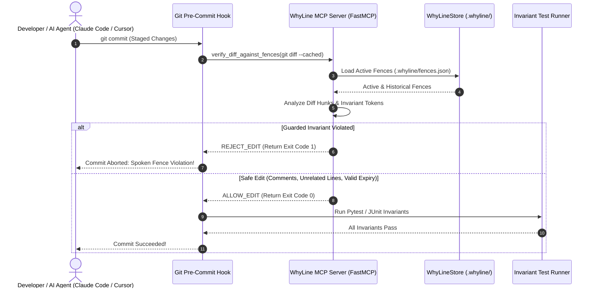

# WhyLine Model Context Protocol (MCP) Server

> **Autonomous AI Agent Interceptor & Deterministic Git Pre-Commit Guardrail.**  
> Built with FastMCP to prevent Claude Code, Cursor, and automated refactoring agents from reverting load-bearing workarounds.

---

## 🎯 Purpose & Threat Model

Autonomous AI coding agents frequently optimize codebases by removing "ugly" patterns:
- Reducing retry counts (`retryCount = 5` $\rightarrow$ `retryCount = 1`).
- Removing blocking pauses (`Thread.sleep(120)` $\rightarrow$ deleted).
- Re-enabling strict SSL verification in legacy staging environments.
- Deleting swallowed catch blocks handling flaky third-party hardware.

These "cleanups" silently cause catastrophic production regressions. **WhyLine MCP Server** acts as an active gatekeeper between AI agents, code editors, and git commits. When an agent or developer attempts to modify a guarded file, WhyLine inspects the unified diff hunks, verifies line ranges against active Spoken Fences, and blocks the edit if it compromises an invariant.



---

## 🛠️ MCP Tool Definitions

WhyLine registers 4 standard tools using the FastMCP framework:

### 1. `check_fences`
Inspects a file path and optional proposed diff before an agent performs an edit.
```json
{
  "name": "check_fences",
  "description": "Deterministic pre-edit check against Spoken Fences. Returns ALLOW_EDIT or REJECT_EDIT.",
  "parameters": {
    "file_path": "string (path relative to repo root)",
    "proposed_diff": "string? (unified diff snippet)"
  }
}
```
- **Returns**: JSON object detailing decision status (`ALLOW_EDIT`, `REJECT_EDIT`, `CAUTION_HISTORICAL`), violated fence ID, reason, and author postmortem audio URL.

### 2. `verify_diff_against_fences`
Verifies a full unified git diff against the entire repository's fences.
```json
{
  "name": "verify_diff_against_fences",
  "description": "Verifies a multi-file unified git diff against all active and historical fences.",
  "parameters": {
    "repo_path": "string",
    "unified_diff": "string"
  }
}
```
- **Diff-Aware Logic**: Blocks edits only when changed lines intersect `[fence.start_line, fence.end_line]` or delete/alter guarded tokens (e.g. `timeoutMs = 4500`). Safe changes (adding comments, whitespace, editing unrelated functions) are allowed through.

### 3. `log_or_resume_context`
Tracks dead-end debugging attempts and records branch memory.
```json
{
  "name": "log_or_resume_context",
  "description": "Logs a ruled-out dead end or resumes context on branch checkout.",
  "parameters": {
    "action": "'pause' | 'resume' | 'list'",
    "branch_name": "string",
    "context_payload": "string"
  }
}
```

### 4. `get_fence_audio`
Retrieves audio postmortem metadata for a given fence ID.
```json
{
  "name": "get_fence_audio",
  "description": "Fetches audio playback URL and transcript for a Spoken Fence.",
  "parameters": {
    "fence_id": "string (e.g. 'FENCE-001')"
  }
}
```

---

## 🔌 Client Installation & Configuration

### 1. Claude Desktop
Add to your `claude_desktop_config.json`:
```json
{
  "mcpServers": {
    "whyline": {
      "command": "python",
      "args": [
        "-m", "mcp.whyline_mcp"
      ],
      "cwd": "C:/Users/anjan/Downloads/Whyline",
      "env": {
        "PYTHONPATH": "C:/Users/anjan/Downloads/Whyline"
      }
    }
  }
}
```

### 2. Cursor IDE
Add to `.cursor/mcp.json` in your workspace:
```json
{
  "mcpServers": {
    "whyline": {
      "command": "python",
      "args": ["-m", "mcp.whyline_mcp"],
      "cwd": "${workspaceFolder}"
    }
  }
}
```

### 3. Antigravity / Gemini CLI
Add to `mcp_config.json`:
```json
{
  "mcpServers": {
    "whyline": {
      "command": "python",
      "args": ["-m", "mcp.whyline_mcp"],
      "cwd": "."
    }
  }
}
```

---

## 🪝 Git Pre-Commit Hook Integration

WhyLine installs a deterministic git pre-commit hook that guards staged files before `git commit` completes.

### Automatic Installation
```bash
python -m backend.whyline.cli install-hooks
```
This writes `.git/hooks/pre-commit` and `.git/hooks/post-checkout`:
- **`pre-commit`**: Runs `whyline check-staged`. Aborts the commit if any active fence is violated.
- **`post-checkout`**: Runs `whyline resume`. Displays spoken branch dead ends so engineers don't repeat failed attempts.

### Manual CLI Inspection
You can run WhyLine checks on any diff file or directly from standard input:

```bash
# Check staged git changes
whyline check-staged

# Check an arbitrary patch file
whyline check patch.diff

# Pipe unified diff via stdin
git diff HEAD~1 | whyline check -
```

---

## 🧪 Testing the MCP Server

```bash
# Test MCP tool execution under Pytest
pytest tests/e2e/test_tier1_features.py -k test_tier1_mcp -v

# Run FastMCP directly in stdio mode
python -m mcp.whyline_mcp
```
